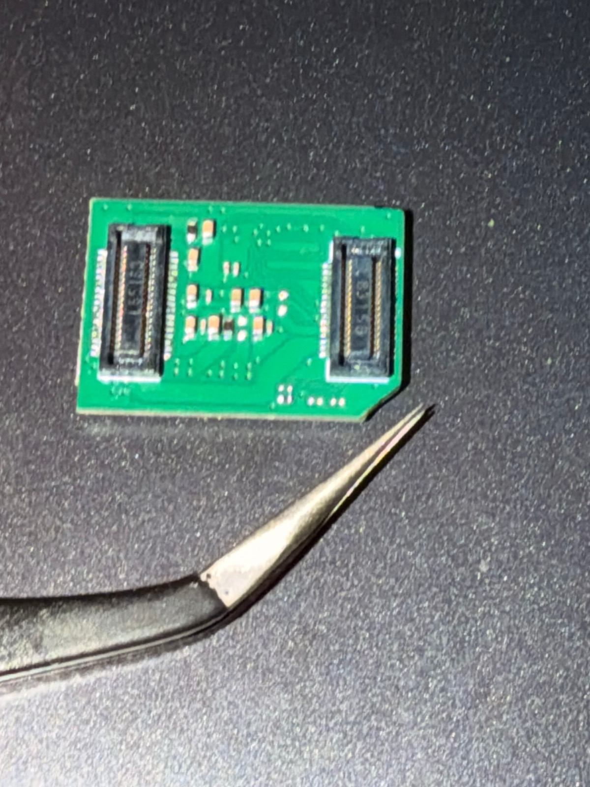
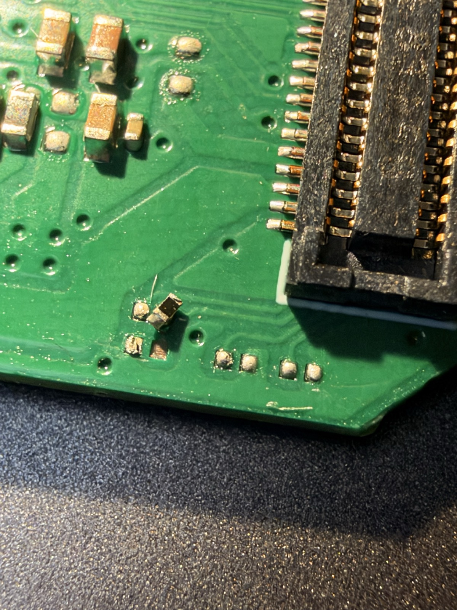
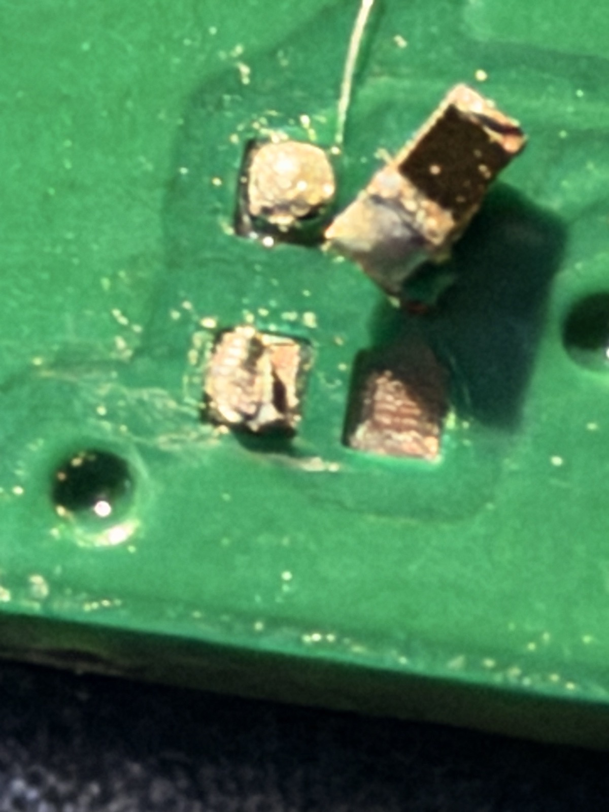
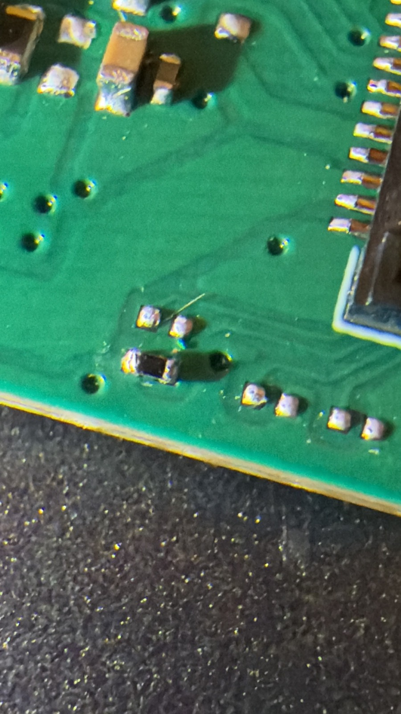

# 2026-09-28

All the commands and logs from today are in [Q6A_LINUX_BOOT.md](Q6A_LINUX_BOOT.md). This is the story of how I got there, in the order it happened, including the back and forth with Claude.


> ****any time you see this, is me conversing with claude****


For context, I'd never really read a schematic at least for a pcb, used EDL or touched Linux boot firmware before today. I woke up not even knowing what UFS stood for lol.

The commands in here are cleaned up a little so they're readable (I cut the SSH flags and long folder paths). The exact ones are in the tech doc.

**If you want to follow along:**

- **EDL commands** (`edl-ng ...`) run on your computer with the board in EDL mode (hold the EDL button while power comes on, and pull Ethernet too if you use PoE). You need Radxa's [`edl-ng`](https://docs.radxa.com/en/dragon/q6a) and the `prog_firehose_ddr.elf` loader from the BIOS package, and you run them from the folder that has the loader in it.
- **Board commands** run on the Q6A itself over SSH. `ssh q6a` is just the name I gave my board in `~/.ssh/config`, so swap in your own `radxa@<board-ip>`.
- **Blocks marked: [ ! ] CAUTION** change or overwrite something. They're here so you can see what I did. Read the warning before you paste one.
- Blocks without a `sh` label are config lines or output, not commands.

*I'm not responsible for anything, if something goes wrong*
---

## 1. Why I switched to Linux

Going into today, I had Gemma 4 E2B running on the Q6A's GPU under Android. I'd also tried the bigger E4B, and Android's low-memory killer shut it down before it even finished loading.

The real goal is getting Gemma 4 onto the NPU, and as far as I can tell nobody's done that on this chip. So this morning I asked Claude to catch up on the project and help me pick the model. It suggested playing it safe with a tiny 1B model, and for what I wanted to do with little guy.. yea that won’t really work.

> **Me:** Did you actually look at the project? It has to do audio, video, thinking, responding, all on a Q6A, bro. So what's the point of running these little models?

Android was never a requirement for me. It was just the fastest way to test. Android was eating a big chunk of my 12 GB, and Qualcomm's NPU tools live on Linux anyway. So Linux was the next reasonable choice.

First try got me a black screen. Installing Android had put Android's boot firmware on the board's SPI chip, and that firmware only knew how to boot from UFS. I'd pulled the UFS out to keep it safe and was booting off a USB stick. We put the board into EDL, the emergency mode burned into the chip, backed up the whole SPI chip, checked it against Android's firmware file, and flashed Radxa's Linux BIOS.

```sh
# Lists the partitions on the SPI chip

edl-ng --memory=Spinor --loader=prog_firehose_ddr.elf printgpt

# Backs up the whole SPI chip to a file

edl-ng --memory=Spinor --loader=prog_firehose_ddr.elf read-lun spinor-lun0-android-20260927.bin


# [ ! ] CAUTION: Flashes the Linux BIOS (run it from the BIOS package's spinor folder)

cd dragon-q6a_flat_build_wp_260120/flat_build/spinor/dragon-q6a
edl-ng --memory=Spinor --loader=prog_firehose_ddr.elf rawprogram rawprogram0.xml patch0.xml
```

> **Me:** This time it worked. I can already tell based off the blinking colors... yep, and there's the blue light.

Idle Ubuntu left about 10 GiB of the 12 free, which already is a step up from androud. Then Claude grabbed Radxa's prebuilt Llama 3.2 1B for this exact NPU, and it just ran. Around 400 tokens per second reading the prompt and 9 to 10 per second writing. I asked it what a little robot would say walking into a coffee shop and it went "Good morning, I'm here to help you with your coffee, I hope you don't mind if I take a seat next to you?” uhhh yea

So before any of the UFS stuff started, the day was already shaping up decent. Linux booting, NPU alive. This whole time Linux was booting off a USB, which to me was fine to test on, but I knew I’d need to get the UFS working.

<details>
<summary>Outline </summary>

Here's why Gemma on the NPU is even possible here. Every token means reading all the model's layers out of memory once, and this board tops out around 22 GB/s:

| Model and weight size | Read per token | Best case | Realistic (~60%) |
| --- | --- | --- | --- |
| E2B, 4 bit | ~1.1 GB | ~19 tok/s | ~11.6 tok/s |
| E4B, 4 bit | ~2.3 GB | ~9.5 tok/s | ~5.7 tok/s |

What each firmware puts on the SPI chip:

| | Android firmware | Radxa Linux BIOS |
| --- | --- | --- |
| Pieces written to the SPI chip | 1 (`XBL`) | 25 (`XBL`, UEFI, TrustZone, hypervisor, settings area…) |
| Can it boot from USB? | no, UFS only | USB, SD, NVMe, eMMC, UFS |

```
XBL in backup == Android package xbl.elf (3665840 bytes)
```

The NPU running Llama 3.2 1B:

```sh
# Downloads Radxa's prebuilt Llama 3.2 1B for the v68 NPU

pip3 install --user --break-system-packages modelscope
~/.local/bin/modelscope download --model radxa/Llama3.2-1B-4096-qairt-v68 --local_dir ~/npu/llama32-1b-4096

# Writes the prompt and runs it on the NPU

cd ~/npu/llama32-1b-4096 && chmod +x genie-t2t-run
echo "In one sentence, what would a small companion robot say when carried into a coffee shop?" > prompt.txt
export LD_LIBRARY_PATH="$PWD" ADSP_LIBRARY_PATH="$PWD"
./genie-t2t-run -c htp-model-config-llama32-1b-gqa.json --prompt_file prompt.txt --profile prof.json
```

| Run | Prompt tokens | Reading the prompt | First word | Writing |
| --- | --- | --- | --- | --- |
| short prompt | 29 | ~97 tok/s | 0.3 s | 9.7 to 10.2 tok/s |
| long prompt | 823 | **404 tok/s** | 2.04 s | 9.1 tok/s |

*mind you these are not optimized npu results*

For reference my GPU setup under Android read prompts at 34 to 74 tok/s.

right after that, the board "died" mid test. Just a green light. I pressed the power button and it came right back, and the uptime said it never reset. Ubuntu's desktop was putting my headless board to sleep after 15 minutes with no keyboard or mouse..

```sh
# Searches the kernel log for sleep events

sudo dmesg | grep "PM: suspend"
```

```
[  989.574434] PM: suspend entry (s2idle)
[ 1045.447822] PM: suspend exit
```

We turned sleep off completely. (duh)

```sh
# Disables every sleep mode for good

sudo systemctl mask sleep.target suspend.target hibernate.target hybrid-sleep.target suspend-then-hibernate.target
```

</details>

## 2. The UFS problem, and the mistake I made at first

The USB stick worked, but it was slow, so I wanted Linux on the UFS.

> **Me:** All right. The UFS is connected. Shall we uh, overwrite it?

Linux running off USB couldn't even see the UFS, so we flashed Radxa's UFS image over EDL instead.

```sh
# [ ! ] CAUTION: Writes the UFS image (the _4096 one, unpacked) to the start of the UFS. Wipes it.

edl-ng --memory=Ufs --loader=prog_firehose_ddr.elf write-sector 0 radxa-dragon-q6a_noble_gnome_r2.output_4096.img --lun 0
```

10 GB in 34 seconds. So the storage itself was fine, EDL could write to it perfectly. I pulled the USB stick and booted.

Solid blue light. No blinking, nothing on the network.

And here's where I messed up. Claude would come up with a fix and I'd go do it. Pull the power, hold the EDL button, flash this, power cycle, plug the USB back in, check, try the next thing. Claude was writing faster than I could plug lol. I trusted him since Linux firmware isn’t my strong suit.

<details>
<summary>Everything we tried before we re-evaluated</summary>

| Test | What it was doing | Result |
| --- | --- | --- |
| Give Linux its own hardware map (`devicetree` line) | can we just turn UFS on for Linux? | UFS still disabled |
| Make the kernel load the map (`dtb=`) | same thing, another way | hung on solid blue |
| Re-provision the UFS to Armbian's single LUN layout | does Android's eight LUN layout confuse the firmware? | nope, no change |
| `rootdelay=20 panic=10` | if Linux starts but can't find its drive, the board reboots in a loop | no loop, meaning Linux never started |
| Put the USB stick's own kernel on the UFS | is the kernel the problem? | still stuck, so it's before Linux boots |

Some of what that looked like:

Lines I added to the boot entry (`/boot/efi/loader/entries/RadxaOS-6.18.2-3-qcom.conf`), these go in the file, not the terminal:

```
devicetree /dtb/q6a-ufs.dtb          ← my own hardware map with UFS flipped to okay
options ... dtb=/dtb/q6a-ufs.dtb     ← or make the kernel load it itself
options ... rootdelay=20 panic=10    ← the reboot loop test
```

```sh
# [ ! ] CAUTION: Re-splits the UFS into one big LUN, using Armbian's file (github.com/armbian/qcombin/pull/2). Wipes it.

edl-ng --memory=Ufs --loader=prog_firehose_ddr.elf provision provision_ufs31_lun0_only.xml
```

</details>

Lots of activity, very little stepping back to think..

> **Me:** Dude, stop these tasks 😭
>
> **Me:** We just need to stand back and think real quick.

Claude gave me a three line summary.

> **Me:** No dude, we went at this for hours and then you think that explanation could be enough LMAO.

That's the turning point. From here I stopped being mainly the hands. I wanted to know what was actually deciding whether the UFS existed, and I wanted to work it out myself.

## 3. Reasoning backward through the boot chain

The first thing I couldn't understand was why USB worked when UFS didn't.

> **Me:** So why are we fighting with the UFS so much? If it can read a USB that's plugged in externally, the UFS shouldn't be any different.

Claude explained that USB is a universal connection with a generic driver. UFS is wired straight into the Qualcomm chip through its own controller, and on this board eMMC and UFS modules share a socket, so the firmware has to work out which one is installed.

 Jokingly i said:
> **Me:** What stands for UFS, by the way? 

(Universal Flash Storage. The least universal thing on this board apparently.)

> **Me:** Linux must have some kind of dedicated criteria that allows it to decide. What is triggering that criteria for it to be like, well, this is actually an eMMC? 

 *(the board was reading the eMMC controller but not the UFS controller)*

> **Claude:** Linux doesn't decide anything here. It gets a device tree from the firmware, and every piece of hardware says okay or disabled. The UFS controller says disabled, so Linux never touches it.

Which after double checking, this what Linux was being handed:

```sh
# Prints the okay/disabled status of each storage controller in the device tree

B=/sys/firmware/devicetree/base/soc@0
for n in mmc@7c4000 ufshc@1d84000 phy@1d87000; do echo "$n: $(tr -d '\0' < $B/$n/status)"; done
```

```
mmc@7c4000:     okay       ← eMMC controller
ufshc@1d84000:  disabled   ← UFS controller
phy@1d87000:    okay       ← the UFS link hardware right next to it
```

So the UFS is already marked dead before Linux even starts. Which means the real question: who has the authority to write that? I went through the boot chain next.

> **Me:** So Linux can't decide. What can decide? The Linux kernel, that's already Linux running, so it's not that. Embloader decides which kernel, it can't be that stage. PBL just picks where to load from, leaving the SPI. which then that just leaves XBL and UEFI firmware, which both live on the SPI. So the SPI must be the one that's picking?

| Stage | Could it be deciding? | Why |
| --- | --- | --- |
| Linux kernel | no | it just obeys the device tree |
| embloader | no | it only picks which kernel to run |
| PBL | no | it just jumps to the SPI chip |
| **XBL and UEFI (on the SPI chip)** | **yes** | the only thing left |

> **Me:** Okay, so what did we put on the SPI today?

Radxa's Linux BIOS writes 25 pieces onto the SPI chip, and Claude laid them all out for me.

<details>
<summary>All 25 pieces on the SPI chip</summary>

**The boot code (the stuff that actually runs)**

| Piece | File | What it is |
| --- | --- | --- |
| `XBL` | `xbl.elf` | the first stage after PBL, sets up RAM and basic hardware |
| `XBL_CONFIG` | `xbl_config.elf` | settings and data for XBL |
| `AOP` | `aop.mbn` | the always-on power manager |
| `TZ` | `tz.mbn` | TrustZone, the security side of the chip |
| `HYP` | `hyp.mbn` | the hypervisor |
| `CPUCP`, `SHRM`, `QUP` | `cpucp.elf`, `shrm.elf`, `qupv3fw.elf` | little helper firmwares (CPU power, shared memory, serial buses) |
| `TZAPPS`, `MULTIIMGOEM` | `tzapps.bin`, `multi_image.mbn` | extra TrustZone apps and OEM images |
| `ImageFv` | `imagefv.elf` | the UEFI firmware itself, basically the actual "BIOS" with the boot menu, drivers, and the device tree fixup |
| `PILFv` | `PILFV.Fv` | extra firmware images that get loaded later |

**Config and data**

| Piece | File | What it is |
| --- | --- | --- |
| `cdt` | `cdt_rs701_wp.bin` | the board config table, which tells the firmware what board it's on. It's only 24 bytes! |
| `PLAT` | `Fat12.bin` | a tiny FAT disk with `ACPI/ACPI.elf` and an empty `uefi_cfg.txt` |
| `SMBIOS` | `smbios.bin` | the board's identity info |
| `DEVCFG` | `devcfg_windows_hyp_rfcomm.mbn` | device config (yes, it says "windows" in the name) |
| `SYSFW_VERSION` | `SYSFW_VERSION.bin` | the firmware version stamp |
| `ddr` | `zeros_5sectors.bin` | RAM training data, flashed blank so it gets redone |
| `VarStore` | no file | the firmware's settings area. The firmware fills in its own defaults on first boot |
| `SD_MGR`, `limits`, `SSD`, `SECDATA`, `APDP`, `DPP` | no file | reserved areas the firmware uses for itself |

</details>

Claude had grouped them by what they do, and I needed to know the order they’d run in.

> **Me:** Are these in perfect order? Like it goes from XBL to eventually CDT, in that order? (for reference CDT runs right after XBL - according to my previous experience at least)
>
> **Claude:** No, and good that you asked. I grouped them by what they do. Here's the order they actually run in at power on.

```
PBL (inside the chip)
 └─► XBL                 sets up the processor basics
      ├─ reads CDT         "what board am I?" (very early!)
      ├─ uses XBL_CONFIG   to set up RAM
      └─ loads AOP, TZ, HYP, CPUCP, SHRM, QUP
 └─► UEFI (ImageFv)      the actual "BIOS"
      ├─ reads VarStore    its settings (boot order, device tree options)
      ├─ starts storage drivers (USB, eMMC or UFS…)   ← where my problem shows up
      ├─ builds and "fixes up" the device tree        ← where "UFS: disabled" gets written
      └─ runs embloader off the drive
```

XBL's whole job is setting up basic hardware, so that's where my gut went.

> **Me:** I actually think it has to do with the XBL. Technically, a UFS is basic hardware.

We pulled the text strings out of the Android and Linux XBL files and compared them. They had the same UFS driver, so Claude didn't think XBL was the cause. 

> **Me:** Just because they're similar doesn't mean they get processed similar. I still think it might be the XBL file. Do we have a way to see how the board is handling it?

That question is what got us the log. Those strings were log messages, and the firmware keeps its log in RAM. Linux had that memory marked reserved and refused a normal read ("Bad address"), but mapping it directly with Python worked. 388 lines of the firmware narrating its own boot.

```sh
# Finds the memory the firmware reserved for itself

sudo dmesg | grep -iE "reserved mem.*(xbl|uefi|smem)"

# Checks that raw memory reads are allowed ("is not set" means yes)

grep STRICT_DEVMEM /boot/config-$(uname -r)

# dd failed with "Bad address", so this reads the UEFI log's memory with Python instead

sudo python3 -c "
import mmap, os
fd = os.open('/dev/mem', os.O_RDONLY | os.O_SYNC)
m = mmap.mmap(fd, 0x10000, mmap.MAP_SHARED, mmap.PROT_READ, offset=0x80884000)
open('uefilog.bin', 'wb').write(m[:])"

# Pulls the readable text (the log) out of it

strings -n 5 uefilog.bin > uefi-log-20260928.txt
wc -l uefi-log-20260928.txt
```

<details>
<summary>The XBL string comparison</summary>

```sh
# Paths to each package's xbl.elf (change these to yours)

LINUX_XBL=dragon-q6a_flat_build_wp_260120/flat_build/spinor/dragon-q6a/xbl.elf
ANDROID_XBL=Q6A-Android15-spi-ufs-boot-20260630-b1/spinor/xbl.elf

# Pulls the storage-related text out of each one

S='ufs|emmc|sdcc|boot.?dev|storage|volt'
strings -a "$LINUX_XBL"   | grep -iE "$S" | sort -u > xbl_linux.txt
strings -a "$ANDROID_XBL" | grep -iE "$S" | sort -u > xbl_android.txt

# Shows what's only in one of them

comm -13 xbl_linux.txt xbl_android.txt    # only in Android's XBL
comm -23 xbl_linux.txt xbl_android.txt    # only in Linux's XBL
```

```
===== ONLY IN ANDROID XBL
-MmUFS 3.x Device Volt set to 2.5 volt
UEFIExitUfsSSURequired = 1
UFS GEAR: %d
===== ONLY IN LINUX XBL
 dUFS GEAR: %d
iUFS 3.x Device Volt set to 2.5 volt
DisplayDxe: Error set voltage source for DSI_BL_PWM
===== IN BOTH
## UFS ##
/core/storage/ufs
Boot Device : UFS
UFS INQUIRY ID: %s
ufs_get_device_info failed
```

`-MmUFS 3.x…` and `iUFS 3.x…` are the same message, `strings` just grabbed junk bytes in front. The one real difference I spotted was `UEFIExitUfsSSURequired` only being in Android's.

</details>

### Reading the logs further

I copied the log to my Mac, and I went through it. These are the lines that matter in our case, with their line numbers, in the order the board printed them:

```
182  UEFI Ver    : 6.0.260120.BOOT.MXF.1.0.1-00549-KODIAKWP-1
184  Boot Device : NVME
204  Card Detection FAILED! Handle 0, Slot 0
205  eMMC module not found
206  External SD card not found
208  UFS GPIO7 value is 1
209  Skipping UFS initialization
 …
230  UFS_IsPresent: Locate MemCardInfo Protocol failed: Not Found
 …
304  [QcomBds] Boot Device Order:
305  [QcomBds]   [0]: USB
 …
309  [QcomBds]   [4]: UFS
310  [QcomBds] Trying device 0: USB
 …
368  [WARNING] linux_load_default_dtb: no valid dtb found
369  [WARNING] embloader_prepare_boot: load device tree failed
370  [INFO] embloader_fetch_fdt: found existing fdt in system table at 0xfa81a018
371  [WARNING] linux_load_dtbos: no dtbo directory configured, skip apply dtbo
372  [DEBUG] efi_dtfixup: applying efi dtfixup protocol
373  [INFO] efi_dtfixup: efi dtfixup applied successfully
 …
380  UFS_IsPresent: Locate MemCardInfo Protocol failed: Not Found
384  [INFO] embloader_start_efi: start efi image...
```

I started at the bottom of the log though, because my train of thought is always this: I know X thing managed to do X thing, meaning if I start from where it had success, I can go backwards from there. Knowing the boot did work, I looked as to WHY it worked on the USB, knowing the UFS was connected the whole time. So going to the bottom and scroll a tiny bit up, that's where things were visibly breaking. embloader (Radxa's bootloader) tries to load its own device tree, fails, and grabs the one the firmware left in memory (368 to 371). A few lines later, `UFS_IsPresent ... Not Found` (380). My first thought was okay, that’s not correct.

Then I scrolled up looking for the first time UFS shows up at all. Line 208. `UFS GPIO7 value is 1`, then `Skipping UFS initialization`. That's the first spot. Every UFS thing that goes wrong comes after it.

> **Me:** Do you remember the DTB errors that I mentioned? They show up after the UFS GPIO7 value is one. That most likely points to the problem happening at the boot-loader level, before the Linux kernel even starts its own device tree.

At 208 the firmware reads a pin and decides there's no UFS. At 209 it skips starting the UFS driver. So when something at 230 asks "is there a UFS?", there's nothing there to answer, and it prints `Not Found`. Same thing at 380, right at hand-off to Linux, which is exactly when the firmware fixes up the device tree Linux gets. And the boot order at 304 to 310 still lists UFS last, there's just nothing behind it. Hence why playing with the boot-order earlier had no effect; fixup just overwrites it.

So those `Not Found` lines are fallout. By line 209, UEFI had already decided the UFS wasn't physically there, and every error after it is the rest of the boot living with that decision. And I finally had the "criteria" I'd been asking about which is one pin, GPIO7.

> **Me:** When we take out our USB, XBL tries to go to our Linux payload, but because the hardware skipped UFS initialization, LUN 0 is impossible to see at the boot-loader. It's trying, but it can't. It basically 'pulls its eyes out’.

I didn't get all of it right of course. I thought XBL was running a stripped-down profile off the SPI chip and skipping UFS to save space. Claude pointed at the log's own order: `UEFI Ver` prints on line 182, before the GPIO7 check, so the check lives in UEFI, one stage after XBL. (It agreed with the eyes part once you swap XBL for UEFI.) 

When I went back to digging, I found an issue on Radxa's GitHub with the same two lines in someone else's log: `UFS GPIO7 value is 1`, `Skipping UFS initialization`. Their board had no UFS installed. Mine had one sitting right there and was saying the exact same thing.

The firmware reads GPIO7, so we read it too, from Linux. The main processor's pin 7 read `1`, same as the firmware. Then obviously I pulled the module and pushed it back in firmly. Still `1`.

<details>
<summary>Finding the pin 7</summary>

The board has a few GPIO chips, so first we had to figure out which "pin 7" the firmware meant.

```sh
# Lists the GPIO chips

gpiodetect
```

```
gpiochip0 [c440000.spmi:pmic@8:gpio@c000] (12 lines)   ← power chip
gpiochip1 [c440000.spmi:pmic@1:gpio@8800] (10 lines)   ← power chip
gpiochip2 [c440000.spmi:pmic@2:gpio@8800] (9 lines)    ← power chip
gpiochip3 [c440000.spmi:pmic@0:gpio@b000] (4 lines)    ← power chip, no pin 7
gpiochip4 [f100000.pinctrl] (176 lines)                ← the main processor
gpiochip5 [33c0000.pinctrl] (15 lines)                 ← audio block
```

Then read pin 7 on every chip that has one. (My first try used `gpioget -c`, which is the newer syntax. This Ubuntu has the older tools, so it's just the chip name and the line.)

```sh
# Reads pin 7 on each chip

for c in 4 0 1 2; do printf "gpiochip$c line 7:  value: "; gpioget gpiochip$c 7; done
```

```
gpiochip4 line 7:  value: 1
gpiochip0 line 7:  value: 0
gpiochip1 line 7:  value: 0
gpiochip2 line 7:  value: 0
```

</details>

So the firmware and Linux agreed. The pin says there's no UFS. Now the question was why.

## 4. The A/B test that turned software into a hardware prediction

It took me a few wrong theories to get to the A/B test, so here they are in order.

### The chicken and the egg

My first theory was power.

> **Me:** I still think this has to do with the controller, dude. Something has to send power to the UFS. It itself does not have power. If it doesn't get power, it can't send a single signal saying, hey, I'm here. So it just gets ignored.

Claude called it a chicken-and-egg problem, and it fit for a while. The UFS's 2.96 V rail even read disabled. But that rail is shared with the eMMC controller, and Linux's eMMC driver had switched it off itself after finding no eMMC, so that reading didn't prove anything either way.

<details>
<summary>How we checked the power rails</summary>


The device tree doesn't name the UFS's power rails, it just stores a number (a phandle) pointing at each one. So this matches those numbers to the real regulators:

```sh
# Matches each of the UFS's power supplies to its regulator and prints whether it's on

D=/sys/firmware/devicetree/base/soc@0/ufshc@1d84000
for s in $D/*-supply; do
  ph=$(od -An -tx4 --endian=big $s | tr -d " ")
  for r in /sys/class/regulator/regulator.*; do
    p=$r/of_node/phandle
    [ -f $p ] && [ "$(od -An -tx4 --endian=big $p | tr -d " ")" = "$ph" ] &&
      echo "$(basename $s) -> $(cat $r/name)  state=$(cat $r/state)"
  done
done
```

```
vcc-supply -> vreg_l7b_2p96  state=disabled
```

Then I booted with `regulator_ignore_unused`, so Linux wouldn't switch off rails it thinks nobody's using. Still disabled.

```sh
# [ ! ] CAUTION: Adds regulator_ignore_unused to the boot entry's kernel options (back the file up first)

sudo sed -i "s|^options |options regulator_ignore_unused |" /boot/efi/loader/entries/RadxaOS-6.18.2-3-qcom.conf
```

</details>

I was also looking at how the module physically connects.

> **Me:** When I look at the board, the top connector is UFS, the bottom connector is eMMC. My module seats into both. So is it reading power from both ends? Because if it's only getting eMMC power and not UFS power, that's also concerning.

Hold onto that one, it gets answered later.

### The fixup is just the messenger

Next we went after who actually writes `disabled`. Before Linux gets the device tree, both embloader and the firmware run a "fixup" on it. I had Claude turn both off. The firmware one put the board in a restart loop, and we had to restore its settings byte for byte from the backup over EDL. (Blooper: the first time, I ran the commands on my Mac instead of the board lol.)

<details>
<summary>What the fixup changed, and getting the board back</summary>

[ ! ] CAUTION: **Don't copy these two unless you're ready to restore over EDL.** Turning the firmware fixup off is what put my board in the restart loop.

Turning off embloader's fixup is one line in a config file I had to create:

```yaml
# /boot/efi/embloader/config.static.yaml

efi:
  dtfixup: false
```

Turning off the firmware's own fixup means writing a firmware setting from Linux. This is the one I first ran on my Mac lol:

```sh
# Unlocks the firmware setting, then sets it to 0 (off)

F=/sys/firmware/efi/efivars/DeviceTreeAutoFixup-882f8c2b-9646-435f-8de5-f208ff80c1bd
sudo chattr -i $F
printf "\x07\x00\x00\x00\x00" | sudo tee $F >/dev/null
```

To see what the fixup actually changes, compare the kernel's own map with the one Linux really got:

```sh
# Saves the device tree Linux actually got, and converts both it and the kernel's original to text

sudo cat /sys/firmware/fdt > after-fixup.dtb
dtc -s -I dtb -O dts after-fixup.dtb > after.dts
dtc -s -I dtb -O dts /usr/lib/linux-image-6.18.2-3-qcom/qcom/qcs6490-radxa-dragon-q6a.dtb > before.dts

# Shows what the fixup changed

diff -u before.dts after.dts
```

The whole fixup was this:

| Where | Before | After the fixup |
| --- | --- | --- |
| `chosen` | nothing | boot options, memory map, `radxa,dtb-fixup-applied` |
| UFS crypto engine `1d88000` | on | `disabled` |
| **UFS controller `ufshc@1d84000`** | **`okay`** | **`disabled`** |
| **watchdog `17c10000`** | **`reserved`** | **`okay`** |

That watchdog line is probably why turning the fixup off caused the restart loop.

Reading the settings store by hand, every setting is stored twice like two save slots:

```
0x6767c  01 00 00 00                  data size = 1 byte
0x67680  28 00                        name size = 40 bytes
0x67682  D.e.v.i.c.e.T.r.e.e.A.u.t.o.F.i.x.u.p..
0x676ac  01                           the value, 1 = auto fixup on
```

Getting the board out of the restart loop, from EDL on my Mac. The settings area starts at sector 138 on the SPI chip, so I saved the broken copy first, then wrote back the good one from my backup:

```sh
# Saves the broken settings area, then [ ! ] CAUTION: writes the good copy from my backup back over it

edl-ng --memory=Spinor --loader=prog_firehose_ddr.elf read-sector 138 160 varstore-before-restore-looping.bin
edl-ng --memory=Spinor --loader=prog_firehose_ddr.elf write-sector 138 varstore-20260928-fixup-on.bin
```

```
varstore-before-restore-looping.bin  DeviceTreeAutoFixup -> 00, 00
varstore-after-restore.bin           DeviceTreeAutoFixup -> 01, 01
VERIFIED: VarStore restored to fixup-on copy
```

</details>

> **Me:** Um, what does the fixup do again? Exactly?
>
> **Claude:** The firmware takes the map, edits a few lines to match what it found at boot, and passes the edited version on.
>
> **Me:** Okay. Hold on. "The firmware takes the map, edits a few lines to match what it found at boot, and passes the edited version on." Read that again.
>
> **Claude:** Yes, I see it. "To match what it found at boot." The fixup is just the messenger. It honestly writes down what the firmware found, and what the firmware found is wrong.

Same lesson as the log. We'd been fighting a symptom. Claude offered a workaround where I'd just leave the USB stick plugged in forever… I’m in too deep now.

> **Me:** You think I'd just half ass things? When I hit a roadblock, I just throw in the towel? That's not what I'm about, bro. This is fun. This is what builds my skill set.

### What EDL already knew

I took a quick break, as it was about 5 hours of uninterrupted work and when I came back one thing still didn't add up, so I started off by asking:

> **Me:** We know the UFS works because we were able to write to it. So in the condition where you were able to write LUN 0, what state was that?
>
> **Claude:** In EDL we told it "this is UFS." On a normal boot, the firmware detects it with GPIO7. That's the only difference.

```
Normal boot:  PBL → XBL → UEFI → checks GPIO7 → "1" → skips UFS
EDL:          PBL → skips the SPI chip → firehose loader → we say --memory=Ufs → powers UFS → works
```

In EDL the loader powers the UFS up and talks to it with no presence check at all. I ran the EDL tool myself and it even told us the module's name, a Samsung `KLUEG8UHDC-B0E1`. Then I pulled the UFS out and ran it again, and the loader crashed. So EDL really was talking to real hardware.

```sh
# (This is bkerler's edl tool, github.com/bkerler/edl)
# Tries to read GPIO7's register directly (blocked by this loader)

edl peekdword 0x0F107004

# Asks the loader what storage is attached

edl getstorageinfo --memory=ufs --loader=prog_firehose_ddr.elf

#  → mem_type: UFS, manufacturer_id: 462 (Samsung), prod_name: KLUEG8UHDC-B0E1
#  → same command with the UFS pulled: USBError(5, 'Input/Output Error')
```

Claude also guessed secure boot was on, based on a hash EDL printed. Right after that I found this in the chip's own boot log:

```
S - Boot Interface: SPI
S - Secure Boot: Off
```

So that guess was out too.

### Time to think


> **Me:** It boots off USB, but not on the UFS, and the UFS works in EDL. It's pre-kernel. GPIO is one. So now it's more of why.

so I started tracing things out in my head, mumbling to claude (I was learning this as I was going, so my train of thought is messy)

> **Me:** GPIO 7. Electrical present strap. UFS_DET to QCS6490 GPIO_7. The GPIO is active low with a pull up. So there's a pull up on the host side, and most likely that chain is open, therefore GPIO7 naturally becomes one. That makes the likely cause a bad or misaligned connector, specifically on the DET pin. So I gotta check the resistance and continuity from the module's UFS DET contact to ground, and from the contact to the Q6A's net, then boot and measure the actual voltage. Could this be a fusing issue? When installing Android it required me to efuse.
>
> **Claude:** Fuses can't hold a pin at a voltage, so that's one worry you can drop. And since it's a plain wire to ground, it doesn't need power. The chicken and egg part is out. But your measurement plan is exactly right.

The detect line is a passive strap. The module just ties the pin to ground to say "I'm here", and that works whether the UFS is powered or not.

### The A/B test

I didn't have a multimeter, so… we use the board as the meter. Linux can read every pin's level without touching it (`sudo cat /sys/kernel/debug/gpio`). Before we ran it, I found the storage connector's pinout, which has three detect lines right next to each other:

| Connector pin | Signal | Means, when grounded |
| --- | --- | --- |
| 19 | `UFS_DET` | "I'm a UFS module", goes to GPIO_7 |
| 20 | `FSPI_DET` | "I'm a flash (SPI) module" |
| 21 | `EMMC_DET` | "I'm an eMMC module" |
| 16, 22, 24, 27, 30 | GND | ground |

With the module in, the pins around GPIO7 looked like this:

```sh
# Shows pins 6 to 9 from the full pin list

sudo grep -E "^ gpio[6-9] " /sys/kernel/debug/gpio
```

```
gpio6   : in  low   pull down
gpio7   : in  high  pull up      ← UFS_DET, high means "no UFS"
gpio8   : in  high  pull down    ← high even though the chip is pulling it down
gpio9   : in  high  pull down    ← same
```

GPIO8 and GPIO9 reading high against the chip's own pull down meant something on the board was pulling them up, so they were probably the other two detect lines. All three high meant the board saw no module of any kind.

Then the actual A/B test. Snapshot with the module in, power off, module out, boot, snapshot again, compare.

```sh
# Snapshots every pin with the module in

ssh q6a 'sudo cat /sys/kernel/debug/gpio' > gpio-module-IN.txt

# Takes a second snapshot after powering off, pulling the module and booting again

ssh q6a 'sudo cat /sys/kernel/debug/gpio' > gpio-module-OUT.txt

# Checks that neither file is empty, then compares them

wc -l gpio-module-IN.txt gpio-module-OUT.txt
diff gpio-module-IN.txt gpio-module-OUT.txt && echo IDENTICAL
```

```
231 gpio-module-IN.txt
231 gpio-module-OUT.txt
IDENTICAL
```

Not one pin changed. Electrically, the board couldn't tell "UFS installed" apart from "empty socket". That's when hardware became suspect number one.

### The module's schematic

Then I found the UFS module's own schematic. Three of its detect resistors are marked NC (not fitted), and one is fitted.

> **Me:** NC... with, a resistor.

```
J1 pin 21  EMMC_DET  R11  0 ohm   (NC)  to GND
J1 pin 20  FSPI_DET  R10  0 ohm   (NC)  to GND
J1 pin 19  UFS_DET   R2   10k     (NC)  to VCC_1V8
                     R9   0 ohm         to GND
```

R9 is a 0 ohm resistor, basically a tiny wire, from `UFS_DET` to ground. That one part is the entire "I'm a UFS" signal. And my two connector question got answered here: the module's second connector, the one in the eMMC side, has nothing wired to it at all. It's just there to hold the module in place.

So the prediction got really specific. Somewhere between connector pin 19, through R9, to ground, the path is open. Either that connector contact isn't touching, or R9 itself is broken. Go look.

## 5. The microscopic fault

Here's the thing. The module looked completely fine. Connector pins straight, nothing burnt, nothing out of place. I'd pulled it in and out a bunch of times that day and never looked twice. For scale, here's the whole module next to my tweezers:



*The whole module, with my tweezers for scale. R9 lives in that tiny 2 by 2 group of dots along the bottom edge, near the cut corner. (I took this one a bit later, right after putting R9 back, because I needed people to understand how small this thing is.)*

There was zero reason to go staring at one corner of that with a phone camera until the log, the GPIO diff and two schematics all pointed at the same spot.

I started taking photos with my phone zoomed all the way in. The connectors looked fine. Claude kept asking for more photos, and I was running out of patience.

> **Me:** Dude.

Then I got this one.



*That's as zoomed in as my phone goes before things get blurry roughly 14x zoom on a 18 pro. The little black part sitting up at an angle, bottom middle, is R9. It's about the size of a grain of sand.*

> **Me:** This looks like some kind of surface-mount resistor!!!!!!



*R9, lifted at one end and barely hanging on. The bottom left pad has torn solder and the one next to it is bare copper, where the solder came away with the part.*

That's the open path. Exactly what the schematic predicted.

> **Me:** How is it supposed to lay? Vertical or horizontal? And that little black part, should that go down or up?

Flat, one metal end on each pad, black side up. I placed it with those tweezers. Claude thought I might have picked the wrong pair of pads, based on where it could see solder, and warned that bridging two footprints could short 1.8 V to ground.

I thought the footprints around it made it pretty clear.

> **Me:** Point being is context awareness. Look to the right. There's two dots and then two dots. Those look like singular entities. That little black square obviously wasn't connected to the far right two dots. So these are individual pairs, meaning my only reasonable spot is where I placed it.
>
> **Claude:** Your reasoning is better than mine here. I was treating that block as a puzzle on its own, and you used the context around it.

Roughly what I was looking at, with the connector up and to the right:

```
   [dome] [dome]              ← top pair: two neat untouched solder domes = R2, never fitted
   [torn] [bare copper]       ← bottom pair: where the damage was = R9
                          [dome][dome]   [dome][dome]   ← R10 and R11, unfitted, horizontal pairs
```

Every unused footprint next to it ran horizontally in pairs, so I followed the pattern.



*R9 back on its pads. Not soldered, just sitting there.*

Claude asked whether I had a soldering iron, and before I'd even answered, Claude Code's autocomplete had already typed "i dont have a soldering iron" into my message box lol. Nothing local, so I ordered an iron, solder paste and thin solder wire for tomorrow.

## 6. The repair doesn't immediately work

I actually called it a day at that point, and we wrote everything up. Then I just sat there.

> **Me:** I'm actually so tempted to try it just to plug the UFS in. Just plug it in extraordinarily carefully... I really want to end on a good note, like a good verdict, bro.

Claude thought installing the module with R9 unsoldered was a bad idea, because it pictured me flipping the module upside down onto the board.

> **Me:** That's where you're wrong. It actually sits upright. The pins on the module are pointing upwards, the pins on the board are pointing downwards. I just hover the board over the connector and seat it on. I don't have to flip anything over.

I seated it and powered on, sweating the whole time. This is the check I ran every time from here on, the pin, what the firmware told Linux, and whether a UFS drive shows up:

```sh
# Checks the detect pin, the UFS controller's status, and the list of drives

ssh q6a 'echo "GPIO7: $(gpioget gpiochip4 7)"
         echo "ufshc: $(tr -d "\0" < /sys/firmware/devicetree/base/soc@0/ufshc@1d84000/status)"
         lsblk -o NAME,SIZE,TRAN'
```

Plus the `/dev/mem` trick from earlier to grab the firmware's log again. Here's what came back:

```
GPIO7: 1
ufshc: disabled
UFS GPIO7 value is 1
Skipping UFS initialization
```

> **Me:** That's really strange..

I checked the placement against Radxa's product photo and it was right, same pads… Not possible the train of thought is bulletproof.

> **Me:** Are we sure we're not screwing something up with the firmware? It would have to work.
>
> **Claude:** The GPIO reading is a raw electrical fact. The pin is an input with a weak pull up, and a real path to ground would read 0 no matter what the firmware thinks. It's the unsoldered contact.

True, that's the same logic that got me to R9 in the first place. A pin with a pull up reads 1 when nothing connects it to ground, and no firmware can make a grounded pin read 1 (It was getting late, so my brain was burning out). So the path was still open, which meant R9 was sitting on the pads without actually touching both of them.

I could've left it there and waited for the iron.. but I’m not ending there; instead I carefully reseated it one more time.

## 7. LET'S GO


> **Me:** LET'S MF GO BROOOOOO. DON'T PLAY WITH ME.

```
UFS GPIO7 value is 0
UFS INQUIRY ID: SAMSUNG KLUEG8UHDC-B0E1 0200
UFS GEAR: 4
```

GPIO7 read `0`. The firmware found my Samsung and ran it at Gear 4, full speed. `ufshc: okay`, and a 238 GB drive showed up in Linux. 

> **Me:** So now we test. Let's boot from it. 

Claude put the UFS image's original boot partition back straight from Linux, no EDL needed.

```sh
# Confirms sda is really the Samsung UFS before writing to it

lsblk -b -o NAME,SIZE,LOG-SEC,MODEL /dev/sda

# [ ! ] CAUTION: Writes the original boot partition (saved from Radxa's image) back onto sda2

gunzip -c /tmp/ufs_efi.img.gz | sudo dd of=/dev/sda2 bs=4M conv=fsync
```

I pulled the USB stick out super gently and powered on.

```sh
# Shows the drives, and which one the system booted from

lsblk -o NAME,SIZE,MOUNTPOINTS; findmnt -o TARGET,SOURCE,FSTYPE /
```

```
NAME   SIZE   MOUNTPOINTS
sda    238.4G
├─sda1 128M   /config
├─sda2 1G     /boot/efi
└─sda3 237.1G /
TARGET SOURCE    FSTYPE
/      /dev/sda3 ext4
```

Booted from the UFS, no USB stick. Same board that started the day unable to put a picture on screen.

## Looking back

"Go check the hardware" sounds obvious now. Staring at a solid blue light in the afternoon, it wasn't obvious to me at all. What actually got me there was stopping, and understanding the chain, as-well as reading the log in order, like a timeline, where the first weird line matters most. Same with the pads. Looking at the parts around R9 told me more than staring at R9.

I got things wrong, and so did Claude. XBL, the power theory, secure boot, the wrong pads. We tested those ideas and threw them out, and neither of us were automatically right even though that would’ve been cool. 

I still don't know Linux or UFS inside out. Most of this was new to me when I woke up. But I reasoned through it, asked questions and figured it out as I went. Tomorrow I solder R9 so it stays put.
