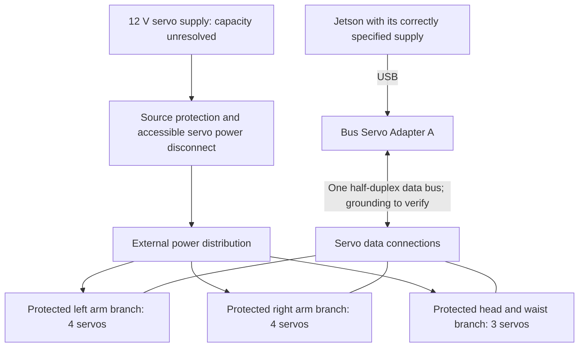

# Preliminary servo power distribution — 2026-10-21

Status: functional architecture and current arithmetic only. The newer [eleven-feed harness candidate](power/README.md) develops the source/return paths and supersedes the three-group power-feed proposal below. No fuse, wire size, supply or switching component has been selected or validated. Schematic pin labels have been traced, but physical plug orientation remains unverified. This document is not a connection instruction.

The [12 V ST3215 specifications](https://docs.waveshare.com/ST3215_Servo) give 0.9 A rated and 2.7 A stall current per servo. The [Bus Servo Adapter A schematic](https://files.waveshare.com/wiki/Bus_Servo_Adapter_A/Bus_Servo_Adapter_A.pdf) marks MAX:6A beside its servo-output power region. Eleven servos must therefore not be treated as an acceptable load through the adapter's power path. These are reference figures, not measured robot current or recommended fuse ratings.

## Earlier grouped architecture (superseded as a wiring proposal)

Separate power branches share the intended servo supply return. Communication remains one half-duplex bus; a power-distribution star does not establish a valid star data topology. Check the manufacturer wiring guidance and verify communication with actual cable lengths. The Jetson's power arrangement stays separate from the servo rail; do not infer that a USB connection supplies the motors.

The adapter's logic/power connections, common reference and possible backfeed paths must be traced from the exact board before designing the harness. In particular, a conventional three-wire daisy-chain also links positive supply rails: adding branch feeds while leaving those rails linked can bypass branch protection and reconnect the adapter's power path. The final schematic must show exactly where positive power is segmented and how signal/return remain connected. Do not improvise a data-only adapter cable from this block diagram.

| Proposed power group | Servos | Sum of rated-current references | Sum of stall-current references |
|---|---:|---:|---:|
| Left arm | 4 | 3.6 A | 10.8 A |
| Right arm | 4 | 3.6 A | 10.8 A |
| Head and waist | 3 | 2.7 A | 8.1 A |
| Total | 11 | 9.9 A | 29.7 A |

At nominal 12 V the total reference powers are 118.8 W and 356.4 W. No-load or average movement may be lower, but this does not establish startup, transient or fault performance. A nominal 10 A supply has essentially no reserve against the rated-current sum. Conversely, choosing a 30 A source would not make the connectors, daisy-chain cables or adapter suitable for that current. Each shared segment must be checked for the downstream load it actually carries.

## Requirements for the detailed schematic and harness

1. **Source behaviour.** Establish allowable voltage at the servo terminals, source current limiting, startup, transient response and response to energy returned by moving loads. The published servo range is 6–12.6 V; do not add voltage to compensate for cable loss without checking maximum terminal voltage during light load and motion. Supply, filtering and any energy-absorption circuit remain unselected.
2. **Protected conductors.** Select each wire, connector and board path for its actual thermal environment, routing, length and maximum permitted current. Coordinate branch protection with the weakest downstream segment and source current-limit behaviour; do not set a fuse from the stall sum alone. Verify that a branch fault cannot draw unprotected current through another branch or through the adapter.
3. **Voltage drop.** Budget round-trip resistance: `voltage drop = branch current × total loop resistance`. For illustration, a 0.5 V drop budget at 10.8 A allows only about 0.046 Ω total loop resistance, including both conductors and all contacts. The 0.5 V value is an example, not a selected requirement or wire-gauge recommendation.
4. **Disconnect behaviour.** Provide an accessible way to remove servo power while keeping the computer available for diagnosis where the final design permits. An electrical disconnect can release a raised limb; the stand, supports and test fixture must account for that. No safety-rated emergency-stop function has been designed.
5. **Host loss.** The adapter is a USB bridge, not an independent motion supervisor. Python freshness checks cannot stop a servo after a process/USB/host failure. Define the required response (hold, controlled stop, supported torque release) before selecting a watchdog or power switch. A watchdog timeout followed by a power cut is not automatically a safe response for this mechanism.
6. **Validation points.** Include accessible voltage/current observation points at the source and distal servos. Under guarded representative motion, measure current peaks, sag, temperature rise, resets and communication errors. Test the chosen disconnect and host-loss response with supported limbs before ordinary use.

## What can be decided now

The [new logical harness](power/README.md) uses eleven individually protected feeds and returns from a hub, avoiding aggregate arm current in a small servo lead. The 4 / 4 / 3 split above is retained for load accounting. Reserve space for the hub and separate arm harnesses in the torso/stand layout. Keep high aggregate servo current out of the adapter power path. Carry a provisional distribution/protection cost outside the earlier supply-only placeholder. Keep the exact supply, wire sizes, connector families, protection devices and final branch grouping open until the detailed schematic and measured load plan support them.

No purchase, physical rewiring, servo configuration change or motor command was performed for this design note.
