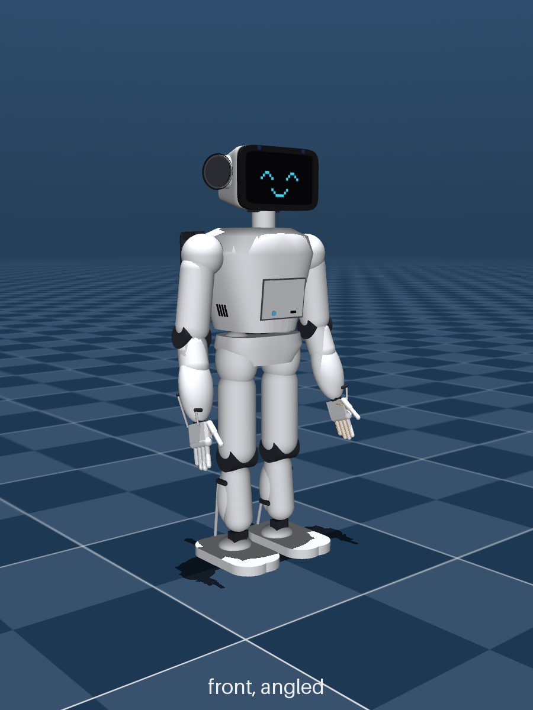

# Little Guy V2 renders (2026-10-25)

Little Guy V2 is a ~60 cm, ~4.25 kg walking humanoid companion robot, designed by Immy (goals, looks, trade-offs)
with Claude (simulation, parts research, code). These are MuJoCo simulation renders, not photos: nothing is built
yet. Every part is being picked and placed with its real size and weight before any learned motion (RL) work.

| Render | What it shows |
|---|---|
| [v2-full-body.png](v2-full-body.png) | Current body from the front, angled front, side and back: screen face, front door (charge port, lit power button), carry handles, exhaust grille and woofer grille on the back. 41 Feetech servos |
| [v2-chest-insides.png](v2-chest-insides.png) | X-ray of the chest after the "real parts" pass: Jetson Orin Nano on the back wall (green), the 6-cell battery stacked low (red), depth camera (yellow), our own boards and unpicked modules as reserved space (purple). Chest made 2 cm deeper so all 6 cells fit below the Jetson |
| [v2-head-ears.png](v2-head-ears.png) | Head A: a 5.55" AMOLED face, two 40 mm speakers in ear cups that turn forward like human ears |
| [v2-head-xray.png](v2-head-xray.png) | Inside the head: screen panel, its driver board, ear speakers, cameras, the four-mic diamond on top |
| [v2-ear-rings-and-feet.png](v2-ear-rings-and-feet.png) | Rubber rings round the ears that land first in a side fall, and the feet |
| [v2-pixel-faces.png](v2-pixel-faces.png) | Pixel-face expressions for the screen |
| [v2-carry-handles.png](v2-carry-handles.png) | Folding carry handles on the back |
| [v2-vents-and-door.png](v2-vents-and-door.png) | Air path: side intakes low, exhaust high at the back, underside vent; front door |

The head, handle and vent renders were made earlier the same day, before the chest got 2 cm deeper; the full-body
and chest renders are the current body. Parts list: [../BOM-full-robot.md](../BOM-full-robot.md).
